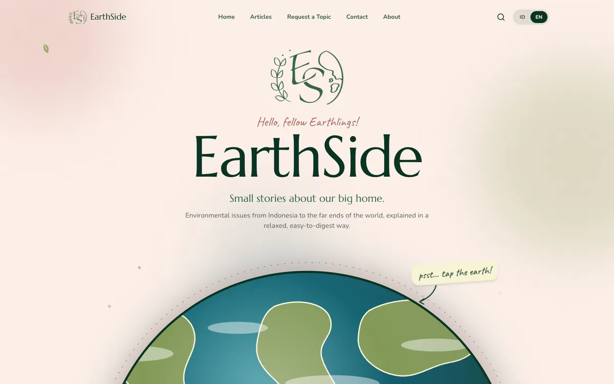
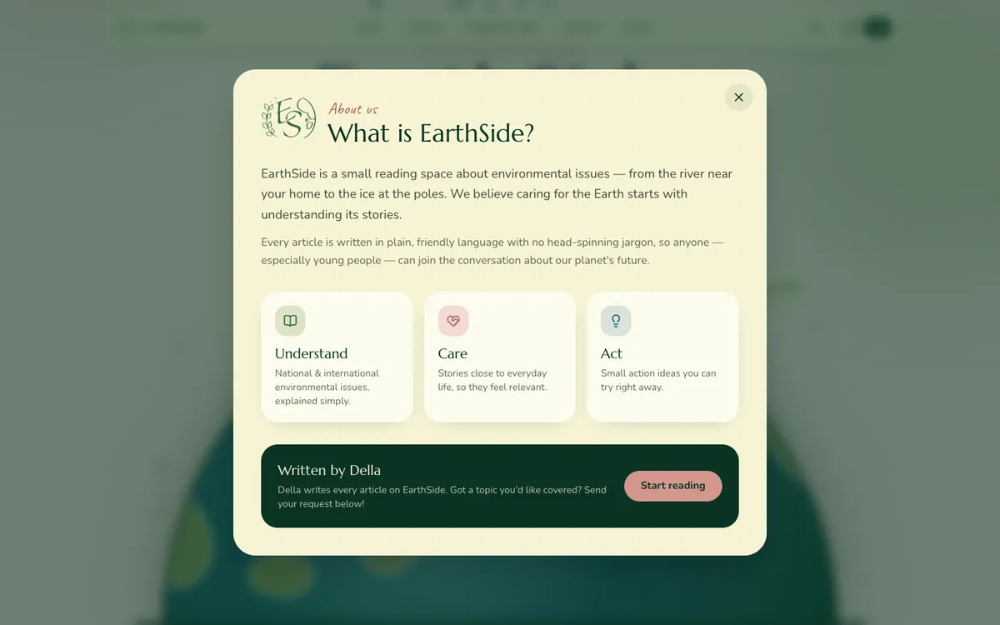
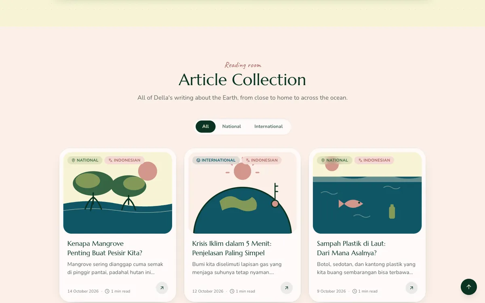
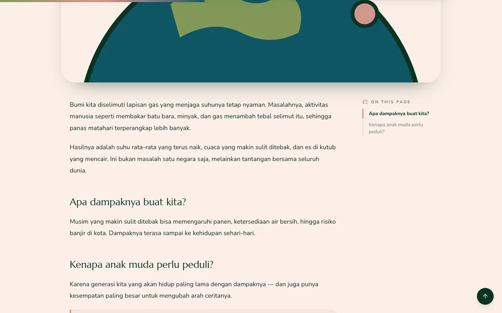
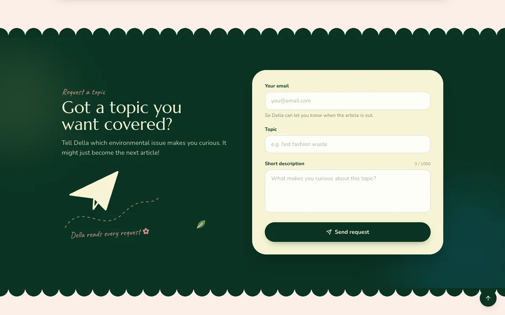
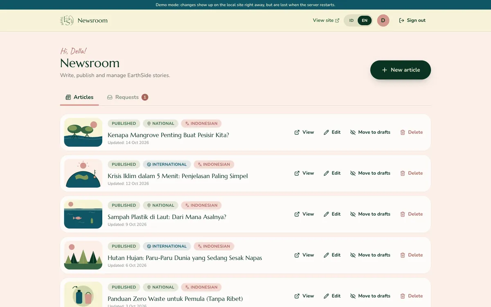
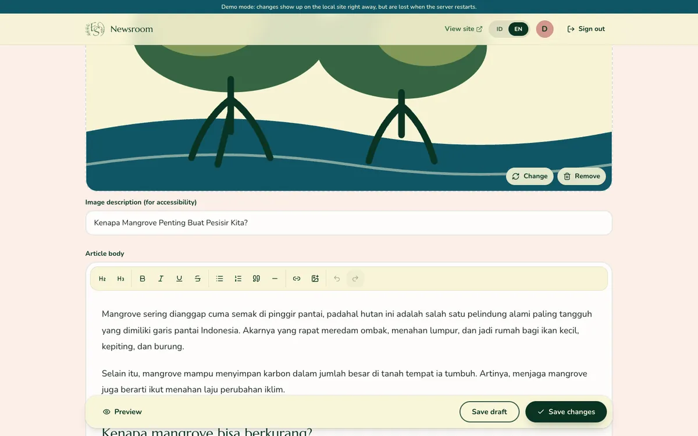
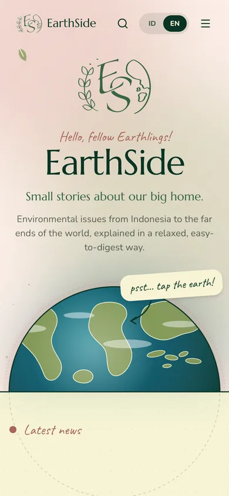
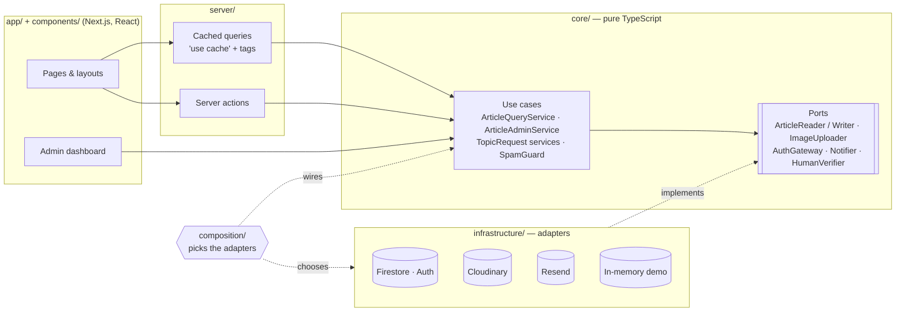

<div align="center">


# EarthSide 🌍

**Small stories about our big home.**

A bilingual reading space about environmental issues — from the river near your home to the ice at the poles —
written in plain, friendly language for young readers.


[Features](#-features) · [Screenshots](#-screenshots) · [Quick start](#-quick-start) · [Architecture](#-architecture) · [Docs](#-documentation)

</div>

---

## 🌱 About

EarthSide is the personal publication of **Della**: a landing page and archive of articles about
**national 🇮🇩 and international 🌏 environmental issues**. It's built for everyone, with a
focus on teenagers and young adults — so the tone is light, the design is playful, and nothing
gets in the way of reading.

- **Readers just read.** No accounts, no likes, no comments — only stories (and a share button).
- **One author, one dashboard.** Articles are written in a private, Google-sign-in dashboard.
- **Readers still have a voice.** Anyone can suggest a topic for a future article.

## ✨ Features

<table>
<tr>
<td width="50%" valign="top">

### For readers

- 🌍 **Interactive half globe** — tap it to open _About us_
- 📰 **Latest news** up front, the full **archive** with National / International filters
- 🔎 **Search**, **table of contents**, reading progress & reading time
- 🇮🇩 / 🇬🇧 **Fully bilingual** — articles follow the language the reader picks
- 💌 **Topic requests** with email, topic and a short description
- ♿ Accessible, responsive, and respectful of _reduced motion_

</td>
<td width="50%" valign="top">

### For the author

- ✍️ **Rich-text editor** with images, headings, quotes and links
- 🌐 **One-click translations** (DeepL) the author reviews before they go live
- 👀 **Preview** exactly what readers will see before publishing
- 💾 **Drafts & local autosave** — closing the tab doesn't lose work
- 📥 **Request inbox** with status, badges and one-click Gmail replies
- 🔔 Optional **email notifications** for new requests
- 🧪 **Separate dev & live data**, clearly labelled in the dashboard

</td>
</tr>
</table>

**Under the hood:** server-rendered and cached pages that refresh the moment an article is saved,
SEO (sitemap, robots, social preview image), real 404s, layered spam protection (honeypot, rate
limit, Cloudflare Turnstile), and page analytics.

## 📸 Screenshots

| Home                                                         | About us                                                         |
| ------------------------------------------------------------ | ---------------------------------------------------------------- |
|  |                      |
| **Article collection**                                       | **Reading an article**                                           |
|               |  |
| **Request a topic**                                          | **Author dashboard**                                             |
|          |                     |

<p align="center">
  
  &nbsp;
  
</p>

## 🧰 Tech stack

| Layer     | Choice                                                                      |
| --------- | --------------------------------------------------------------------------- |
| Framework | [Next.js 16](https://nextjs.org) (App Router, Cache Components, Proxy)      |
| UI        | React 19, Tailwind CSS 4, [Motion](https://motion.dev), Lucide icons        |
| Editor    | [Tiptap 3](https://tiptap.dev) (shared schema for editing and rendering)    |
| Data      | Firebase Firestore (Lite SDK) + security rules                              |
| Auth      | Firebase Authentication — Google sign-in, email allow-list                  |
| Media     | Cloudinary (unsigned uploads) or Firebase Storage                           |
| Extras    | DeepL (translation), Resend (email), Cloudflare Turnstile, Vercel Analytics |
| Quality   | TypeScript strict, Zod, Vitest, ESLint, Prettier                            |

## 🚀 Quick start

> Requires **Node.js 20.19+** (22 or 24 recommended).

```bash
git clone https://github.com/Yalifuddin/EarthSide.git
cd EarthSide
npm install
npm run dev
```

Open <http://localhost:3000>. With no configuration the site runs in **demo mode**: sample
articles are shown and `/en/admin` lets you try the dashboard with a fake sign-in (development only).

To connect real services, copy `.env.example` to `.env.development.local` and follow the
**[setup guide](docs/setup.md)**.

### Environments

Each environment has its **own Firebase project**, so experiments never reach the live site.

| Environment     | Runs with                       | Config file / place                                       | Data                       |
| --------------- | ------------------------------- | --------------------------------------------------------- | -------------------------- |
| **Development** | `npm run dev`                   | `.env.development.local`                                  | Dev project (or demo data) |
| **Preview**     | Vercel preview deployments      | Vercel → _Preview_ variables                              | Dev project                |
| **Production**  | Vercel production / `npm start` | Vercel → _Production_ variables · `.env.production.local` | Live project               |

The dashboard always shows which database you're editing — and warns loudly if a local build
is pointed at the live one.

### Scripts

| Command                        | What it does                                   |
| ------------------------------ | ---------------------------------------------- |
| `npm run dev`                  | Start the development server                   |
| `npm run build` / `npm start`  | Production build / serve it                    |
| `npm test`                     | Unit tests (domain logic)                      |
| `npm run lint` · `typecheck`   | ESLint · route types + TypeScript              |
| `npm run format`               | Format with Prettier                           |
| `npm run firebase:deploy:dev`  | Deploy Firestore rules & indexes to dev        |
| `npm run firebase:deploy:prod` | Deploy Firestore rules & indexes to production |

## 🏛 Architecture

The code follows a layered, _clean architecture_ style: dependencies only point inward, and
framework or vendor code is plugged in at the edges.



```
src/
├── app/[lang]/        Routes — (site)/ for readers, admin/ for the dashboard
├── components/        UI, grouped by feature: landing/ · articles/ · about/ · admin/ · layout/ · ui/
├── core/              Domain entities, validation, use cases and ports (no framework code)
├── infrastructure/    Firebase, Cloudinary, Resend, Turnstile and demo adapters
├── composition/       The only place that decides which adapters are used
├── server/            Cached read models, server actions, Proxy helpers
├── i18n/              Indonesian & English dictionaries, formatting
├── lib/ · hooks/      Small shared helpers
└── proxy.ts           Locale redirects and real 404s for unknown articles
```

Read more in **[docs/architecture.md](docs/architecture.md)**.

## 📚 Documentation

| Document                                     | For                                                         |
| -------------------------------------------- | ----------------------------------------------------------- |
| [docs/setup.md](docs/setup.md)               | Connecting Firebase, Cloudinary, Vercel and optional extras |
| [docs/architecture.md](docs/architecture.md) | How the code is organised, and why                          |
| [docs/design/](docs/design)                  | Original logo, moodboard and sketches                       |

## 💌 Contact

Questions, ideas or collaborations:

- ✉️ **[earthside.contact@gmail.com](mailto:earthside.contact@gmail.com)**
- 📸 Instagram **[@earthside.journal](https://www.instagram.com/earthside.journal)**

<div align="center">
<sub>Made with care for our planet 🌿 · © EarthSide</sub>
</div>
